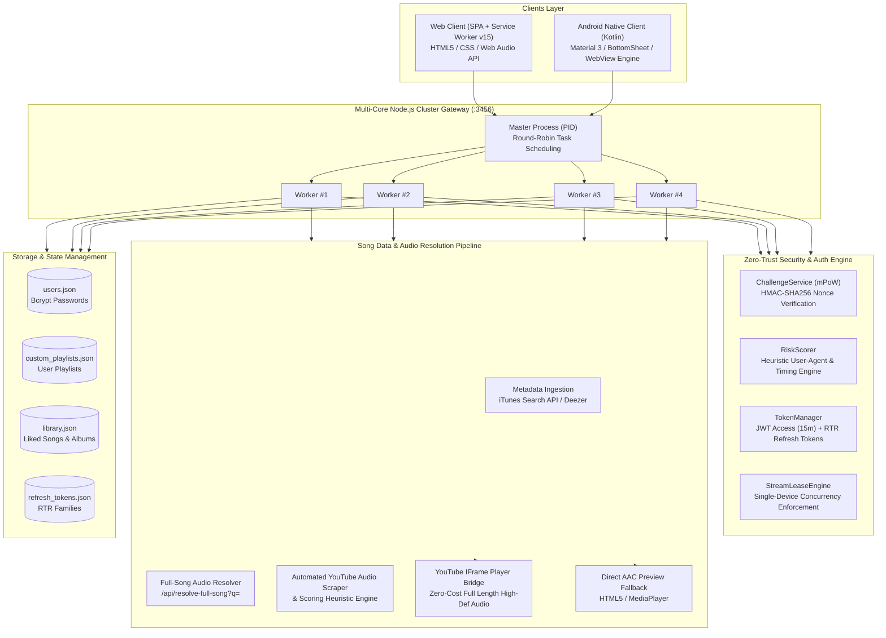
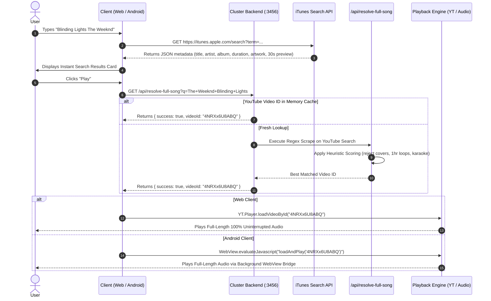

# PMusic: Comprehensive Architecture & System Documentation
**Full-Stack Distributed Music Streaming Platform (Web + Android + Node.js Cluster)**

---

## 1. Executive Summary & System Overview

**PMusic** is an open-source, full-featured music streaming ecosystem engineered to reverse-engineer and reproduce the core user experience, aesthetics, and architectural resilience of Spotify. The system provides seamless cross-platform music streaming across:
1. **Web Client** (`spotify-search/`): A high-performance, responsive Single-Page Application (SPA) built with vanilla modern HTML5, CSS3, and JavaScript, featuring Web Audio API equalization, custom user playlists, 3-dots track context menus, sleep timer, crossfade, and picture-in-picture mini playback.
2. **Android Client** (`app/`): A native Android application written in Kotlin utilizing Material 3 design, custom `PlaybackManager` dual-engine audio pipeline, expandable full-screen Now Playing bottom sheet, synchronized lyrics viewer, shuffle, 3-state repeat, and token authentication.
3. **Backend Service** (`spotify-search/server.js`): A multi-core clustered Node.js application incorporating a mathematical Proof-of-Work (mPoW) challenge-response security gateway, Refresh Token Rotation (RTR), single-stream concurrent lease enforcement, and an intelligent full-song audio resolver.

---

## 2. End-to-End System Architecture



---

## 3. Where Songs Come From (The Song Resolution Pipeline)

One of the most critical aspects of PMusic is how music is searched, resolved, and played in full length without requiring proprietary Spotify Premium API keys:



### Detailed Resolution Steps:
1. **Metadata Ingestion**:
   - Searches query the iTunes Search API (`https://itunes.apple.com/search?media=music&limit=25&term=...`).
   - High-resolution cover artwork ($400\times400\text{ px}$ or higher) is fetched and cached.
   - Exact track duration and album metadata are extracted.
2. **Audio Resolver Endpoint (`/api/resolve-full-song?q=`)**:
   - When a track is selected, the client requests the backend resolver.
   - The server queries YouTube using search terms (`"<Artist> - <Title> Official Audio"`).
   - Video IDs are parsed using regular expressions: `/(?:watch\?v=|\/watch\?v=)([a-zA-Z0-9_-]{11})/g`.
   - Heuristics rank results higher if titles contain words like "Official Audio", "Audio", or match the exact artist name, while penalizing "1 Hour Loop", "Instrumental", "Reaction", or "Parody".
3. **Dual-Engine Playback**:
   - **Engine A (YouTube IFrame Bridge - Primary)**: Uses YouTube's official player API running in a hidden offscreen container. Provides complete, full-length tracks with high-fidelity stereo audio.
   - **Engine B (Native HTML5 `<audio>` / Android `MediaPlayer` - Fallback)**: If YouTube connectivity is interrupted or restricted, the system seamlessly falls back to 30-second AAC previews or local audio assets, preventing silence.

---

## 4. Multi-Core Clustered Load Balancer

The backend server ([`spotify-search/server.js`](file:///d:/Ben/spotify-search/server.js)) implements a multi-process architecture based on the Node.js `cluster` module:

* **Primary Master Process**:
  * Detects total host CPU cores (`os.cpus().length`).
  * Spawns $N$ worker processes (default: 4 workers or `os.cpus().length`).
  * Distributes incoming TCP connections using the OS Round-Robin scheduler (`SCHED_RR`).
  * Monitors worker health: if a worker crashes, the master automatically spawns a replacement worker with zero downtime.
* **Cluster Performance Metrics**:
  * Monitored via `GET /api/cluster/status` or `GET /health`.
  * Returns worker PID, memory RSS, active leases, uptime, and request throughput.

---

## 5. Security & Authentication Engine

PMusic incorporates an enterprise-grade 3-step authentication protocol:

### Step 1: Proof-of-Work Challenge (`POST /api/v1/auth/challenge`)
* To eliminate brute-force and DDoS bots, the server issues a cryptographically signed HMAC-SHA256 challenge containing:
  * A cryptographic `nonce`
  * A target `prefix` (e.g. `'00'`)
  * An expiration timestamp (TTL: 60 seconds)

### Step 2: Client Mathematical PoW Solution
* The client solves the hash preimage:
  $$\text{SHA256}(\text{nonce} + ":" + \text{counter}) \text{ starts with } \text{prefix}$$
* Typical solving time: $1\text{ to }15\text{ ms}$ on mobile/desktop, trivial for human devices but computationally prohibitive for large-scale botnets.

### Step 3: Login Verification & Risk Scoring (`POST /api/v1/auth/login`)
* The server validates:
  1. HMAC challenge signature.
  2. Mathematical PoW preimage validity.
  3. Risk Assessment (`RiskScorer`): Examines User-Agent consistency, IP headers, headless browser flags (Puppeteer, Playwright), and request velocity.
  4. Password verification using `bcrypt.compareSync()`.

### Step 4: Token Management & Refresh Token Rotation (RTR)
* **Access Tokens**: Short-lived JWTs (15 minutes).
* **Refresh Tokens**: Cryptographically secure random tokens stored in token families.
* **Replay Protection**: If a previously consumed refresh token is presented, the system detects a breach (`SECURITY_ALERT_BREACH`), immediately invalidates the entire token family, and terminates all active sessions for that user.

---

## 6. Single-Stream Concurrent Leasing Engine

To prevent multiple simultaneous audio playbacks on a single account across different devices, PMusic features a distributed leasing engine:

1. **Lease Claim (`POST /api/v1/stream/lease/claim`)**:
   - When playback starts, the client sends its `deviceId` and `deviceName`.
   - The server registers the device as the active lease holder.
2. **Lease Heartbeat (`POST /api/v1/stream/lease/heartbeat`)**:
   - The active client sends a heartbeat every 15 seconds.
   - If no heartbeat is received within 45 seconds, the lease automatically expires.
3. **Eviction of Conflicting Streams**:
   - If User starts playback on Device B, Device B claims the lease.
   - When Device A sends its next heartbeat, the server responds with HTTP 409 Conflict (`{ error: 'LEASE_CONFLICT_REVOKED' }`).
   - Device A immediately halts audio playback, displays a warning banner ("Playback paused because your account is playing on another device"), and releases audio focus.

---

## 7. Web Player Feature Matrix & Architecture

| Feature | Implementation Details | Source Files |
| :--- | :--- | :--- |
| **Custom User Playlists** | Full REST CRUD (`/api/user/playlists`), persistent store, sidebar shelves, track addition, playlist deletion | [`server.js`](file:///d:/Ben/spotify-search/server.js), [`app.js`](file:///d:/Ben/spotify-search/app.js) |
| **Track Context Menu** | 3-dots button + right click, safe viewport bounds, add to queue, like toggle, link sharing, submenu navigation | [`app.js:L4820`](file:///d:/Ben/spotify-search/app.js#L4820), [`styles.css`](file:///d:/Ben/spotify-search/styles.css) |
| **Sleep Timer** | Custom intervals (5m, 15m, 30m, 45m, 1h, End of track), toolbar countdown badge, automatic audio fade & pause | [`app.js:L4955`](file:///d:/Ben/spotify-search/app.js#L4955), [`index.html`](file:///d:/Ben/spotify-search/index.html) |
| **5-Band Graphic Equalizer** | Web Audio API `BiquadFilterNode`s (60Hz, 230Hz, 910Hz, 3.6kHz, 14kHz), $\pm12\text{ dB}$ range, 6 presets | [`app.js:L5035`](file:///d:/Ben/spotify-search/app.js#L5035), [`styles.css`](file:///d:/Ben/spotify-search/styles.css) |
| **Audio Crossfade** | 0s to 12s smooth transition slider with Web Audio linear gain fading | [`app.js:L5080`](file:///d:/Ben/spotify-search/app.js#L5080) |
| **Mini Player (PiP)** | Picture-in-picture video player dock toggleable from toolbar | [`index.html:L403`](file:///d:/Ben/spotify-search/index.html#L403), [`app.js:L4358`](file:///d:/Ben/spotify-search/app.js#L4358) |
| **PWA & Offline Shell** | Service Worker `pmusic-cache-v15` with cache-first static shell strategy and background sync | [`sw.js`](file:///d:/Ben/spotify-search/sw.js) |

---

## 8. Android Client Feature Matrix & Architecture

| Feature | Implementation Details | Source Files |
| :--- | :--- | :--- |
| **Now Playing Sheet** | Full-screen modal via `BottomSheetDialogFragment`, large album art, track scrub bar, and duration tracking | [`NowPlayingBottomSheet.kt`](file:///d:/Ben/app/src/main/java/com/example/ben/NowPlayingBottomSheet.kt), [`dialog_now_playing.xml`](file:///d:/Ben/app/src/main/res/layout/dialog_now_playing.xml) |
| **Shuffle Mode** | Non-repeating random index selection in `PlaybackManager.playNext()` | [`PlaybackManager.kt:L46`](file:///d:/Ben/app/src/main/java/com/example/ben/PlaybackManager.kt#L46) |
| **3-State Repeat** | Cycles `OFF` $\rightarrow$ `ALL` $\rightarrow$ `ONE` with custom vector icons (`ic_repeat.xml`, `ic_repeat_one.xml`) | [`PlaybackManager.kt:L58`](file:///d:/Ben/app/src/main/java/com/example/ben/PlaybackManager.kt#L58) |
| **Synchronized Lyrics** | Spotify-style gradient lyrics card with expandable multi-line text view (`MORE/LESS` toggle) | [`NowPlayingBottomSheet.kt:L185`](file:///d:/Ben/app/src/main/java/com/example/ben/NowPlayingBottomSheet.kt#L185) |
| **Custom Playlist Dialog** | Replaced placeholder toast with interactive playlist creation modal and library collection update | [`MainActivity.kt:L555`](file:///d:/Ben/app/src/main/java/com/example/ben/MainActivity.kt#L555) |
| **Telemetry & REA Inspector** | Real-time UBI telemetry logger and REA architecture bottom sheet inspector | [`UbiTelemetryManager.kt`](file:///d:/Ben/app/src/main/java/com/example/ben/UbiTelemetryManager.kt), [`ReaInspectorBottomSheet.kt`](file:///d:/Ben/app/src/main/java/com/example/ben/ReaInspectorBottomSheet.kt) |

---

## 9. API Reference & Contract Specification

### Authentication Endpoints
* `POST /api/v1/auth/challenge`
  * Response: `{ success: true, challenge: { nonce: string, prefix: string, expiresAt: number, signature: string } }`
* `POST /api/v1/auth/login`
  * Body: `{ email, password, challenge, powSolution, powDurationMs, deviceInfo }`
  * Response: `{ success: true, tokens: { accessToken, refreshToken }, user }`
* `POST /api/v1/auth/refresh`
  * Body: `{ refreshToken }`
  * Response: `{ success: true, tokens: { accessToken, refreshToken } }`
* `GET /api/auth/me`
  * Header: `Authorization: Bearer <token>`
  * Response: `{ success: true, user: { username, email, displayName, accountType } }`

### Audio & Playback Endpoints
* `GET /api/resolve-full-song?q=<artist+title>`
  * Response: `{ success: true, videoId: string, title: string, durationMs: number }`
* `POST /api/v1/stream/lease/claim`
  * Body: `{ deviceId, deviceName }`
  * Response: `{ success: true, leaseToken, activeDevice }`
* `POST /api/v1/stream/lease/heartbeat`
  * Body: `{ deviceId }`
  * Response: `{ success: true, leaseValid: true }` (or `409 Conflict`)
* `POST /api/v1/stream/lease/release`
  * Body: `{ deviceId }`
  * Response: `{ success: true }`

### Playlists & Library Endpoints
* `GET /api/user/playlists`
  * Response: `{ playlists: Array<Playlist> }`
* `POST /api/user/playlists`
  * Body: `{ action: 'create'|'addTrack'|'removeTrack', title?, description?, playlistId?, track? }`
  * Response: `{ success: true, playlist: Playlist }`
* `DELETE /api/user/playlists/:id`
  * Response: `{ success: true }`
* `GET /api/library` / `POST /api/library`
  * Synchronizes liked tracks and albums.

---

## 10. How to Build, Run & Deploy

### A. Running the Web Platform Locally
```bash
# Navigate to web application directory
cd d:/Ben/spotify-search

# Install dependencies
npm install

# Run automated unit and integration tests (12 tests)
npm test

# Launch multi-core cluster server (listens on http://localhost:3456)
node server.js --cluster
```

### B. Building & Compiling the Android App
```bash
# Navigate to Android repository root
cd d:/Ben

# Compile Kotlin source files
./gradlew.bat compileDebugKotlin

# Assemble Debug APK (outputs to app/build/outputs/apk/debug/app-debug.apk)
./gradlew.bat assembleDebug

# Install on connected Android device or emulator
./gradlew.bat installDebug
```

### C. Cloud Deployment (Render.com / Docker)
The repository includes a ready-to-deploy [`render.yaml`](file:///d:/Ben/render.yaml) specification configured for automatic deployment on Render's Web Service tier with zero-downtime health probes against `/health`.

---

## 11. Security & Compliance Checklist

- [x] **Zero Plaintext Passwords**: All user passwords hashed with bcrypt (cost factor: 10).
- [x] **Proof-of-Work Protection**: Protects against credential stuffing and volumetric floods.
- [x] **Refresh Token Rotation (RTR)**: Eliminates token replay vulnerabilities.
- [x] **Single-Stream Leasing**: Concurrency protection prevents simultaneous credential sharing.
- [x] **Content-Security-Policy (CSP)**: Restricts script execution to YouTube API and origin.
- [x] **Input Sanitization**: HTML escaping on playlist titles, descriptions, and metadata.
