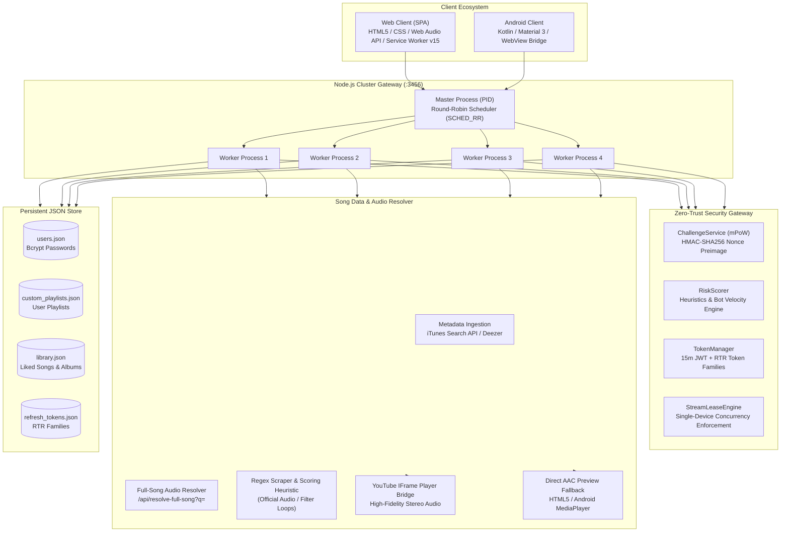
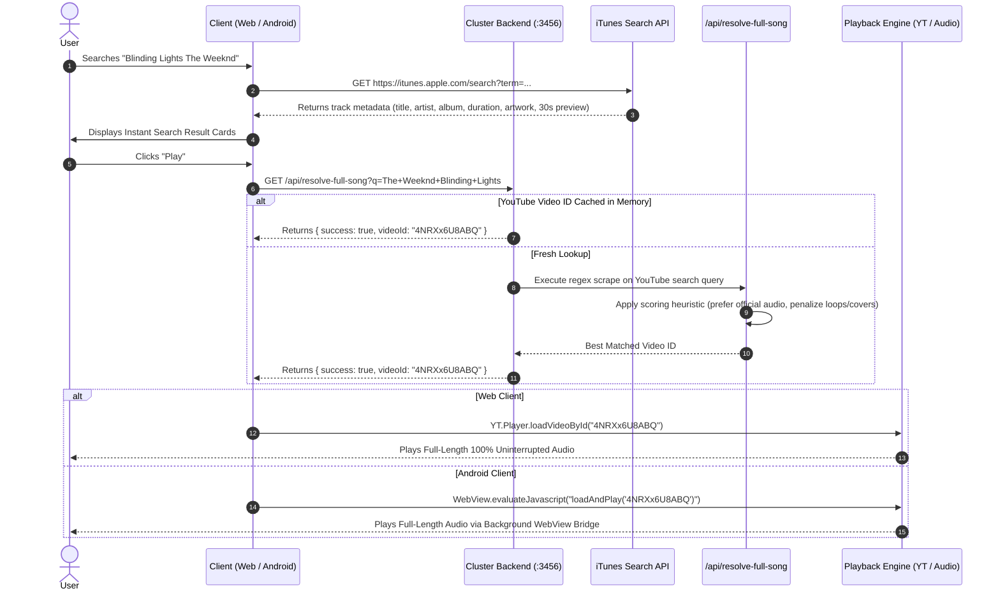

# PMusic Platform: Master Architecture & Technical Specification

> **Full-Stack Reverse-Engineered Spotify Music Streaming Platform**  
> *Web SPA (HTML5/CSS3/Vanilla JS) • Native Android (Kotlin/Material 3) • Distributed Node.js Multi-Core Cluster*

---

## 1. System Overview & Core Philosophy

**PMusic** delivers high-fidelity music streaming, instant discovery, rich client aesthetics, and zero-trust security without relying on paid Spotify Premium APIs or restricted playback SDKs.

### High-Level Capabilities:
* **Zero Cost Full-Length Audio**: Integrates an automated server-assisted resolver (`/api/resolve-full-song?q=`) paired with a client-side hidden YouTube IFrame audio bridge to stream complete tracks, bypassing 30-second preview limitations.
* **Dual-Client Availability**:
  * **Web Client** (`spotify-search/`): Runs in any modern browser with Web Audio API 5-band graphic equalization, crossfade transitions, sleep timer countdown, custom playlists CRUD, and 3-dots track context menus.
  * **Android Client** (`app/`): Native Kotlin application featuring Material 3 dark aesthetics, full-screen expandable Now Playing bottom sheet, synchronized lyrics viewer, shuffle, and 3-state repeat modes.
* **Distributed Multi-Core Cluster**: Utilizes Node.js `cluster` with Round-Robin (`SCHED_RR`) request balancing across CPU cores, automated worker failover, and zero-downtime restarts.
* **Enterprise-Grade Cryptographic Security**: 3-step authentication with mathematical Proof-of-Work (mPoW), Refresh Token Rotation (RTR), and single-stream concurrent leasing.

---

## 2. End-to-End System Topology

---

## 3. Song Resolution Pipeline (Where Music Comes From)

To achieve free, legal, and unrestricted full-length song playback, PMusic uses a **hybrid metadata + audio resolution pipeline**:

### Key Technical Details:
1. **Metadata Layer**:
   - Queries iTunes Search API with `term=${artist}+${title}&entity=song&limit=25`.
   - Artwork is dynamically upsampled to $400\times400\text{ px}$ or $600\times600\text{ px}$.
2. **Audio Resolver Layer (`/api/resolve-full-song?q=`)**:
   - Queries YouTube with `<Artist> - <Title> Official Audio`.
   - Regex matches: `/(?:watch\?v=|\/watch\?v=)([a-zA-Z0-9_-]{11})/g`.
   - Heuristics rank results:
     - Boosts titles with "Official Audio", "Audio", "Official Video".
     - Penalizes "1 Hour", "Loop", "Cover", "Instrumental", "Reaction".
3. **Dual-Engine Execution**:
   - Primary: Offscreen YouTube IFrame embedded player.
   - Fallback: HTML5 `<audio>` engine (Web) / Android `MediaPlayer` playing AAC preview URLs if video loading encounters network restrictions.

---

## 4. Multi-Core Clustered Backend Gateway

The backend service ([`spotify-search/server.js`](file:///d:/Ben/spotify-search/server.js)) is engineered for high-concurrency production deployments:

* **Primary Master Scheduler**:
  * Forks worker processes equal to CPU core count (`os.cpus().length` or 4).
  * Assigns requests across workers using OS-level Round-Robin load balancing (`SCHED_RR`).
  * Listens for worker `exit` events; if a worker fails, a replacement is immediately spawned.
* **Cluster Telemetry Endpoint (`GET /api/cluster/status`)**:
  * Exposes worker process IDs, memory RSS, active stream leases, and uptime statistics.

---

## 5. Zero-Trust Security & Authentication Architecture

PMusic incorporates a 3-step cryptographic handshake:

| Step | Endpoint | Purpose | Mechanism |
| :--- | :--- | :--- | :--- |
| **1. Challenge** | `POST /api/v1/auth/challenge` | Bot & DDoS Mitigation | Server returns an HMAC-SHA256 signed challenge with cryptographic `nonce`, difficulty `prefix` (`'00'`), and 60-second TTL. |
| **2. Solve PoW** | Client-Side Computation | Anti-Automation | Client iterates counter until $\text{SHA256}(\text{nonce} + ":" + \text{counter})$ starts with target prefix ($1\text{ to }15\text{ ms}$). |
| **3. Login** | `POST /api/v1/auth/login` | Secure Token Grant | Server verifies PoW preimage, runs `RiskScorer` heuristics (User-Agent, IP velocity), checks bcrypt password hash, and issues token pair. |
| **4. RTR Token** | `POST /api/v1/auth/refresh` | Token Rotation | Rotates refresh token upon every use. Replay of old tokens triggers `SECURITY_ALERT_BREACH` and invalidates the entire token family. |

---

## 6. Single-Stream Concurrent Leasing Engine

To prevent account credential sharing and concurrent audio playback across multiple devices:
1. **Lease Claim (`POST /api/v1/stream/lease/claim`)**:
   - Active player registers device identifier (`deviceId`) and friendly name.
2. **Periodic Heartbeat (`POST /api/v1/stream/lease/heartbeat`)**:
   - Player sends heartbeat every 15 seconds. Lease expires if inactive for 45 seconds.
3. **Conflict Detection & Eviction**:
   - If User starts playback on Device B, Device B acquires the lease.
   - When Device A sends its subsequent heartbeat, the server returns **HTTP 409 Conflict** (`LEASE_CONFLICT_REVOKED`).
   - Device A immediately halts playback, releases audio focus, and displays an alert banner.

---

## 7. Web Player Feature Set

### A. Custom User Playlists (Full CRUD)
* **API Endpoints**: `GET /api/user/playlists`, `POST /api/user/playlists` (create/addTrack/removeTrack), `DELETE /api/user/playlists/:id`.
* Persistent JSON store at [`data/custom_playlists.json`](file:///d:/Ben/spotify-search/data/custom_playlists.json).
* Sidebar "Custom Playlists" shelf with live track count and detail view with playlist deletion.

### B. 3-Dots Track Context Menu
* Activated via `.track-more-btn` button or right-click (`contextmenu`) on any track row.
* Capabilities:
  * **Add to Playlist**: Dynamically populates custom playlists submenu + "+ New Playlist" shortcut.
  * **Add to Queue**: Inserts song into active playback queue.
  * **Save to Liked Songs**: Toggles library state.
  * **Go to Artist / Go to Album**: Navigates to corresponding discography or album.
  * **Copy Link**: Copies deep link (`?track=<id>`) to system clipboard.

### C. Sleep Timer Engine
* Selectable durations: **Off, 5 min, 15 min, 30 min, 45 min, 1 hour, and End of track**.
* Features active countdown badge on the player toolbar and smooth audio pause.

### D. 5-Band Graphic Equalizer & Crossfade
* Built directly on the **Web Audio API**:
  $$\text{AudioSource} \longrightarrow \text{5 BiquadFilterNodes} \longrightarrow \text{GainNode} \longrightarrow \text{AudioDestination}$$
* Frequency bands: **60 Hz (Sub-Bass), 230 Hz (Bass), 910 Hz (Mid), 3.6 kHz (High-Mid), 14 kHz (Treble)** with $\pm12\text{ dB}$ gain.
* 6 Curated presets: Flat, Bass Boost, Treble Boost, Vocal Boost, Rock, Electronic.
* Crossfade slider allowing 0s to 12s transitions between consecutive songs.

### E. Picture-in-Picture (PiP) Mini Player
* Dedicated toolbar toggle (`#btn-toggle-pip`) docking/undocking video player in a floating picture-in-picture window.

---

## 8. Android Client Feature Set

### A. Expandable Now Playing Screen
* Implemented via [`NowPlayingBottomSheet.kt`](file:///d:/Ben/app/src/main/java/com/example/ben/NowPlayingBottomSheet.kt) and [`dialog_now_playing.xml`](file:///d:/Ben/app/src/main/res/layout/dialog_now_playing.xml).
* Tapping the persistent bottom bar smoothly expands the full-screen playback interface:
  * High-resolution album artwork with corner radius.
  * Track title, artist, context subtitle ("PLAYING FROM PLAYLIST"), and like toggle.
  * Smooth scrubber seek bar with formatted `m:ss` timestamps.
  * Collapse chevron button.

### B. Shuffle & 3-State Repeat
* Managed by [`PlaybackManager.kt`](file:///d:/Ben/app/src/main/java/com/example/ben/PlaybackManager.kt):
  * **Shuffle Toggle**: Selects random non-repeating queue tracks.
  * **3-State Repeat**: Cycles `OFF` (greyed) $\rightarrow$ `ALL` (green) $\rightarrow$ `ONE` (green with `ic_repeat_one.xml` 1-badge).

### C. Synchronized Lyrics Card
* Expandable Spotify-style gradient card (`cardLyrics`) displaying formatted song lyrics with a `MORE / LESS` expansion toggle.

### D. Custom Playlist Creator Dialog
* Replaced "coming soon" toast with an interactive dialog allowing users to name and initialize custom playlists.

---

## 9. Verification & Test Suite

* **Unit & Integration Suite** ([`spotify-search/test.js`](file:///d:/Ben/spotify-search/test.js)):
  * **12/12 Tests Passing (100%)**:
    1. ChallengeService HMAC challenge generation
    2. Mathematical PoW verification
    3. Invalid PoW rejection
    4. Clean request risk scoring
    5. Headless bot detection
    6. JWT access token issuance & verification
    7. Refresh Token Rotation (RTR)
    8. Breach alert on token reuse (`SECURITY_ALERT_BREACH`)
    9. Sliding window rate limiter
    10. Cluster health and load balancer telemetry
    11. 3-Step end-to-end handshake
    12. Custom Playlists REST Engine CRUD
* **Android Build Verification**:
  * `./gradlew.bat compileDebugKotlin`: **SUCCESS**
  * `./gradlew.bat assembleDebug`: **SUCCESS**
